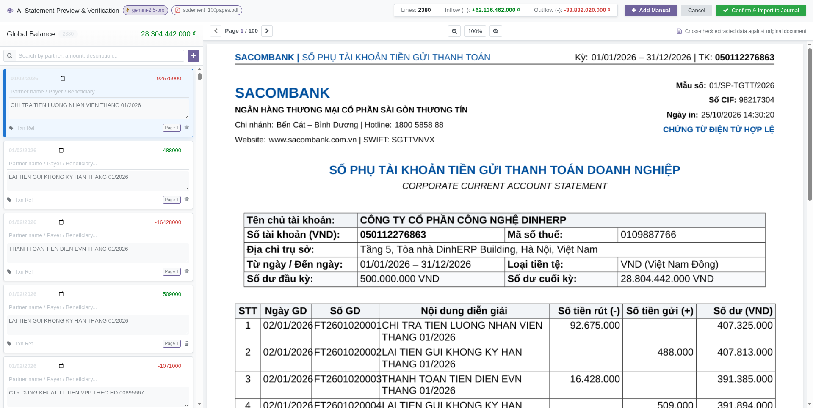
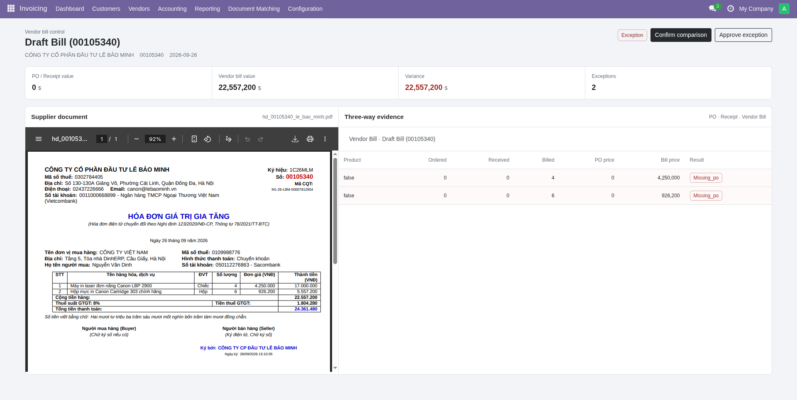
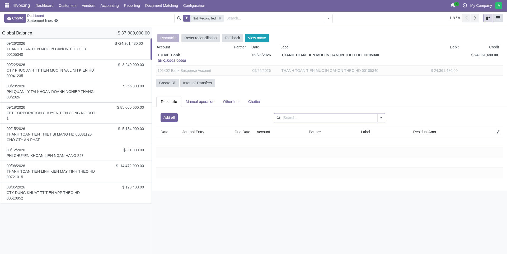

# MCP Reconcile & Purchase Three-Way Matching

[](https://www.odoo.com)
[](https://www.python.org)
[](LICENSE)
[](https://modelcontextprotocol.io)

An enterprise-grade financial management and reconciliation suite for **Odoo 18 Community Edition**, featuring:
1. **Model Context Protocol (MCP) AI Document Processing**: Automated extraction for vendor bills and massive bank statements (100+ pages, 2,000+ transaction lines).
2. **Interactive Purchase Three-Way Matching Workspace**: Side-by-side verification comparing supplier invoice PDFs against Purchase Orders (PO) and Goods Receipts (GRN/Stock Pickings).
3. **Full Bank Reconciliation Stack**: Bringing modern, interactive bank statement reconciliation back to Odoo Community Edition with OCA reconciliation models.

---

## Visual Tour

### 1. AI Statement Preview & Verification
Upload scanned or digital bank statements (up to hundreds of pages). MCP parses transactions in parallel with OCR and LLMs (e.g., Gemini 2.5 Pro / Claude), presenting an interactive side-by-side verification dialog before any accounting moves are created.


*Figure 1: Interactive side-by-side verification dialog reviewing a 100-page Sacombank statement with 2,380 lines, inflow/outflow checksums, and inline editing.*

---

### 2. Purchase Three-Way Matching Workspace
When vendor bills are scanned or imported, our dedicated OWL workspace displays the original supplier PDF document on the left and the three-way matching evidence (PO, Receipt, Vendor Bill) on the right.


*Figure 2: Three-Way Matching workspace highlighting line-item discrepancies, missing PO warnings, variance totals, and manager exception approvals.*

---

### 3. Bank Statement Line Reconciliation
A comprehensive bank reconciliation interface for Odoo 18 Community Edition, powered by OCA addons. Match statement lines against invoices, bills, journal items, or manual write-offs with real-time balance calculations.


*Figure 3: Bank statement reconciliation workspace with statement line drawer, counterpart matching, suspense account handling, and quick transfer tools.*

---

## Included Addons

| Addon | Purpose | Key Dependencies |
| :--- | :--- | :--- |
| **`account_reconcile_3way_matching`** | Provides the Three-Way Matching models, tolerance rules, and OWL split-view workspace comparing PO, Receipts, and Vendor Bills. | `account`, `purchase_stock` |
| **`account_reconcile_mcp_support`** | Local MCP document processing client, statement upload dropzone, and side-by-side AI verification wizard. | `account_reconcile_oca`, `account_reconcile_3way_matching` |
| **`account_reconcile_3way_mcp`** | Connects Accounting dashboard drag-and-drop uploads directly into MCP parsing and opens the Three-Way Matching workspace. | `account_reconcile_3way_matching`, `account_reconcile_mcp_support` |
| **`account_reconcile_oca`** | Full-featured bank statement reconciliation dashboard and interactive reconciliation widgets for Odoo Community. | `account_statement_base`, `account_reconcile_model_oca`, `base_sparse_field` |
| **`account_reconcile_model_oca`** | Automated reconciliation rules, write-off models, bank fee distribution, and tax rules. | `account` |
| **`account_statement_base`** | Foundational bank statement models, statement lines, and dashboard integration for Community accounting. | `account` |

---

## Key Features

### 🤖 MCP-Powered Intelligent Document Processing
- **High-Volume Bank Statement Parsing**: Tested on 100+ page statements with 2,000+ transactions (Sacombank, Vietcombank, Techcombank, etc.).
- **Hybrid Extraction Pipeline**:
  - *Fast path*: Deterministic regex/table parser for digital PDFs and spreadsheets (zero LLM token cost).
  - *Vision / LLM path*: Parallel batch processing via MCP (Gemini 2.5 Pro / Flash / Claude) for scanned receipts and complex layouts.
- **Side-by-Side Pre-Commit Verification**: Review parsed lines directly alongside the PDF page before committing to journals.
- **Self-Balancing Integrity**: Automatic reconciliation of starting balance, debit sum, credit sum, and ending balance.

### ⚖️ Purchase Three-Way Matching (PO vs. Receipt vs. Bill)
- **Line-by-Line Variance Detection**: Matches ordered quantity, received quantity (stock pickings), and billed quantity with PO unit price vs. billed unit price.
- **Configurable Variance Tolerances**: Set percentage and amount thresholds. Small discrepancies automatically pass; significant deviations trigger `exception` status.
- **Strict Accounting Control**: Prevent posting vendor bills unless three-way matching has succeeded or a purchase manager explicitly approves the exception.
- **Embedded PDF Viewer**: View the supplier invoice in real-time inside Odoo without downloading external files.

### 🏦 OCA Bank Statement Reconciliation
- Replaces the missing Enterprise reconciliation widget in Odoo Community.
- Full support for multi-currency reconciliation, partial payments, and partner auto-matching.
- One-click actions: Reconcile, Mark To Check, View Move, Create Bill, and Internal Transfer.

---

## Repository Structure

```text
mcp_reconcile_3way_matching/
├── custom_addons/
│   ├── account_reconcile_3way_matching/     # 3-Way matching logic & OWL workspace
│   ├── account_reconcile_3way_mcp/          # Dashboard upload & match bridge
│   ├── account_reconcile_mcp_support/       # MCP client & AI preview dialog
│   ├── account_reconcile_model_oca/         # OCA reconciliation models
│   ├── account_reconcile_oca/               # OCA reconciliation interface
│   └── account_statement_base/              # Base bank statement models
├── docs/
│   ├── screenshots/
│   │   ├── ai-statement-preview.png         # Figure 1: AI preview modal
│   │   ├── purchase-3way-matching.png       # Figure 2: 3-Way matching workspace
│   │   └── bank-statement-reconciliation.png# Figure 3: Bank reconcile screen
│   ├── ARCHITECTURE.md                      # Module interactions & technical design
│   ├── MCP_SETUP.md                         # MCP server installation & configuration
│   ├── THREE_WAY_MATCHING.md                # 3-Way matching workflow & tolerance rules
│   ├── BANK_RECONCILIATION.md               # Bank statement import & reconcile guide
│   └── VIETNAMESE_GUIDE.md                  # Hướng dẫn chi tiết bằng Tiếng Việt
└── README.md
```

---

## Installation & Setup

### 1. Prerequisites
- **Odoo 18.0 Community Edition**
- **Python 3.10+**
- **OCA Addon**: `base_sparse_field` (clone from [OCA/server-tools](https://github.com/OCA/server-tools))
- **MCP Client**: `mcp_client.py` service running locally or accessible via HTTP/SSE.

### 2. Configure Odoo Addons Path
Add the `custom_addons` directory and the path containing `base_sparse_field` to your `odoo.conf`:

```ini
[options]
addons_path = /path/to/odoo/addons,/path/to/server-tools,/path/to/mcp_reconcile_3way_matching/custom_addons
```

### 3. Install Addons
Install the complete stack in dependency order:

```bash
./odoo-bin -c /path/to/odoo.conf -d <your_database> \
  -i account_statement_base,account_reconcile_model_oca,account_reconcile_oca,account_reconcile_3way_matching,account_reconcile_mcp_support,account_reconcile_3way_mcp \
  --stop-after-init
```

### 4. Start the MCP Document Extraction Service
Navigate to the MCP client directory and start the local service:

```bash
cd custom_addons/account_reconcile_mcp_support/client
python3 mcp_client.py
```
*By default, the service listens on `127.0.0.1:8785` (configurable via `MCP_PORT`).*

---

## Typical Workflows

### Workflow A: Processing Vendor Bills with 3-Way Matching
1. From the **Accounting Dashboard**, click **Upload** on the Vendor Bills journal card.
2. Select one or more PDF/image invoices.
3. The MCP service extracts supplier VAT, invoice number, date, and line items.
4. Odoo creates a draft Vendor Bill linked to the PDF attachment.
5. Click **3-Way Matching** to open the split-screen matching workspace.
6. Verify line items against the Purchase Order and Goods Receipt (GRN).
7. If quantities and prices match (or fall within tolerance), click **Confirm comparison** and post the bill.

### Workflow B: Importing & Reconciling Bank Statements
1. Go to **Accounting > Bank and Cash**, select your bank journal, and click **Import Statement (MCP)**.
2. Drag and drop the bank statement file (PDF, XLSX, or CSV).
3. The **AI Statement Preview & Verification** dialog appears:
   - Verify transaction dates, descriptions, and net flow amounts against the PDF viewer.
   - Edit, delete, or manually add lines if necessary.
4. Click **Confirm & Import to Journal**.
5. Go to **Dashboard > Statement Lines** to perform bank reconciliation with open invoices or suspense accounts.

---

## Documentation

For comprehensive technical and operational guides, consult:
- 📖 [Architecture & Technical Design](docs/ARCHITECTURE.md)
- 🔌 [MCP Server Configuration & AI Setup](docs/MCP_SETUP.md)
- ⚖️ [Purchase Three-Way Matching Operational Guide](docs/THREE_WAY_MATCHING.md)
- 🏦 [Bank Statement Import & Reconciliation Guide](docs/BANK_RECONCILIATION.md)
- 🇻🇳 [Hướng dẫn sử dụng chi tiết (Tiếng Việt)](docs/VIETNAMESE_GUIDE.md)

---

## License

Each addon preserves its original declared license:
- `account_reconcile_3way_matching`: LGPL-3
- `account_reconcile_3way_mcp`: LGPL-3
- `account_reconcile_mcp_support`: LGPL-3
- `account_statement_base`: LGPL-3
- `account_reconcile_model_oca`: LGPL-3
- `account_reconcile_oca`: AGPL-3
