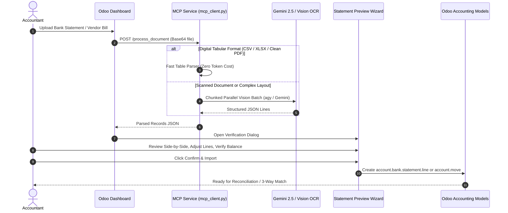

# Architecture & Technical Design

This document details the software architecture, module interactions, data flows, and frontend component design of the **MCP Reconcile & Purchase Three-Way Matching** stack for Odoo 18 Community Edition.

---

## 1. High-Level Architecture Overview

```text
+-----------------------------------------------------------------------------------+
|                              Odoo 18 Community Web UI                             |
|                                                                                   |
|  +-----------------------------+    +------------------------------------------+  |
|  |  Statement Preview Dialog   |    |    Purchase Matching Workspace (OWL)     |  |
|  |  (Side-by-side statement)   |    |    (Supplier PDF vs PO / GRN Evidence)   |  |
|  +-----------------------------+    +------------------------------------------+  |
|                 ^                                        ^                        |
|                 |                                        |                        |
|  +-----------------------------+    +------------------------------------------+  |
|  |   Bank Reconcile Widget     |    |   Accounting Dashboard Drag & Drop       |  |
|  |   (account_reconcile_oca)   |    |   (account_reconcile_3way_mcp)           |  |
|  +-----------------------------+    +------------------------------------------+  |
+-----------------|----------------------------------------|------------------------+
                  |                                        |
                  v                                        v
+-----------------------------------------------------------------------------------+
|                                Odoo Backend ORM                                   |
|                                                                                   |
|  [account.bank.statement.line]  <-- [statement.preview.wizard]                    |
|                |                                                                  |
|  [account.move (Vendor Bill)]   <-- [reconcile.purchase.match]                    |
|                |                               |                                  |
|                +------- PO & Stock Lines ------+                                  |
+---------------------------------|-------------------------------------------------+
                                  | HTTP / JSON-RPC
                                  v
+-----------------------------------------------------------------------------------+
|                        MCP Document Extraction Service                            |
|                          (client/mcp_client.py)                                   |
|                                                                                   |
|  +---------------------------+   +---------------------------------------------+  |
|  | Fast Local Parser         |   | AI Vision & LLM Batch Engine                |  |
|  | (Tabular PDF / XLSX / CSV)|   | (Gemini 2.5 Pro / Flash / Claude via agy)   |  |
|  +---------------------------+   +---------------------------------------------+  |
+-----------------------------------------------------------------------------------+
```

---

## 2. Module Responsibilities & Dependencies

### 2.1. `account_reconcile_3way_matching`
- **Core Model**: `reconcile.purchase.match` (inherits `account.reconcile.match.mixin`, `mail.thread`, `mail.activity.mixin`).
- **Functionality**:
  - Automatically correlates an `account.move` (Vendor Bill) with related `purchase.order` records and `stock.picking` records.
  - Generates line-by-line comparison items (`reconcile.purchase.match.line`): Ordered Qty, Received Qty, Billed Qty, Expected Unit Price, Billed Unit Price, and Variance Amount.
  - Determines matching states: `draft`, `matched`, `within_tolerance`, `exception`, `approved`, `posted`.
  - Integrates an interactive OWL single-page workspace (`PurchaseMatchWorkspace`) rendering the supplier document PDF alongside line-item comparison tables.
  - Enforces company-level blocking settings (`reconcile_block_unmatched_purchase_bills`) to prevent bill validation when exceptions exist.

### 2.2. `account_reconcile_3way_mcp`
- **Inherited Model**: `account.journal`.
- **Functionality**:
  - Overrides the Accounting Dashboard vendor bill upload button.
  - Transmits uploaded documents to the MCP extraction client.
  - Resolves partner via VAT or business name, instantiates the draft `account.move`, attaches the PDF, and initializes the `reconcile.purchase.match`.
  - Seamlessly redirects the user directly into the OWL Three-Way Matching workspace.

### 2.3. `account_reconcile_mcp_support`
- **Core Models & Wizards**:
  - `mcp.client.connector`: High-performance HTTP client connecting to `127.0.0.1:8785`.
  - `statement.upload.wizard`: Dropzone-based upload interface with file drag-and-drop.
  - `statement.preview.wizard`: Transient staging model holding extracted transactions before committing to Odoo.
- **Frontend Components**:
  - `StatementPreviewDialog`: Split-screen verification modal showing extracted cards on the left and full PDF document navigation on the right.
  - `DropzoneBinaryField`: Custom file upload widget with visual status feedback.

### 2.4. `account_reconcile_oca`, `account_reconcile_model_oca`, & `account_statement_base`
- **Reconciliation Engine**:
  - Restores full bank reconciliation capabilities to Odoo 18 Community.
  - Manages bank statements, statement lines, and suspense account clearing.
  - Matches statement lines against partner ledger items, customer invoices, and vendor bills.
  - Applies automated reconciliation models (bank charges, write-offs, exchange rate differences).

---

## 3. Data Processing Pipeline



---

## 4. Security & Multi-Company Design

1. **Company Isolation**:
   - All records (`reconcile.purchase.match`, `statement.upload.wizard`, `account.move`) enforce `check_company=True`.
   - Security record rules ensure users cannot view or match documents across unpermitted companies.

2. **Access Control**:
   - `account.group_account_invoice` is required to view matching workspaces and review draft bills.
   - `purchase.group_purchase_manager` is strictly required to execute `action_approve` on matches in `exception` status.
   - Sudo escalation is restricted exclusively to reading raw attachments during MCP processing where explicit ownership checks pass.

3. **Audit Trail**:
   - State transitions (`draft` -> `matched` / `exception` -> `approved` -> `posted`) are tracked in the Odoo chatter mail thread with user timestamps and variance remarks.
