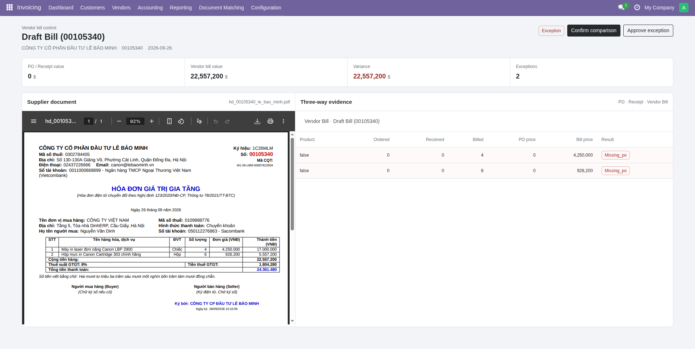

# Purchase Three-Way Matching Guide

Three-Way Matching is an essential internal control mechanism in corporate procurement and accounts payable. It guarantees that the business only pays for goods that were formally authorized in a **Purchase Order (PO)**, verified as received via a **Stock Receipt (GRN / Picking)**, and accurately billed in the **Vendor Bill**.


*Figure: The interactive OWL matching workspace comparing the supplier PDF invoice against PO and receipt records.*

---

## 1. Core Principles

```text
       [ Purchase Order ]  -----> Authorized Quantity & Contract Price
               |
               v
       [ Stock Receipt ]   -----> Physically Received & Inspected Quantity
               |
               v
       [  Vendor Bill  ]   -----> Invoiced Quantity & Claimed Price
```

The system verifies two core vectors:
1. **Quantity Verification**:
   $$\text{Billed Quantity} \le \text{Received Quantity} \le \text{Ordered Quantity}$$
2. **Price Verification**:
   $$\text{Billed Unit Price} == \text{PO Contract Unit Price}$$

---

## 2. Matching States & Workflow

| State | Status Badge | Definition & System Behavior |
| :--- | :--- | :--- |
| **`draft`** | Draft | Initial state when the bill or match record is created. |
| **`matched`** | Matched (Green) | Quantities and unit prices across all line items reconcile perfectly. |
| **`within_tolerance`** | Within Tolerance | Minor discrepancies exist but fall strictly within company tolerance thresholds. Auto-cleared for payment. |
| **`exception`** | Exception (Red) | Significant variance detected (e.g., price increase, over-billing, missing PO, or unreceived goods). Bill validation is blocked. |
| **`approved`** | Approved | A designated Purchase Manager has reviewed the discrepancy and authorized payment override. |
| **`posted`** | Posted | The underlying vendor bill has been validated and recorded in financial ledgers. |

---

## 3. The Interactive Matching Workspace

The matching workspace (`PurchaseMatchWorkspace`) is an OWL single-page application that replaces traditional multi-tab checking:

### 3.1. Header & Summary KPIs
- **PO / Receipt Value**: Expected payable sum calculated from confirmed receipts at PO unit prices.
- **Vendor Bill Value**: Actual total claimed by the supplier on the uploaded invoice.
- **Variance**: Net difference between actual and expected sums. Color-coded in red when variance is non-zero.
- **Exceptions**: Count of line items currently violating matching rules.

### 3.2. Split-Screen Document Verification
- **Left Panel (Supplier Document)**:
  - Directly renders the uploaded PDF (`hd_00105340_le_bao_minh.pdf`) or high-resolution invoice image inside an embedded browser viewer.
  - Zoom, page rotate, page navigate, and download controls without leaving Odoo.
- **Right Panel (Three-Way Evidence)**:
  - Displays breadcrumb links to the Vendor Bill, Purchase Order, and Stock Picking.
  - Detailed line-item table comparing:
    - **Product**: Matched product name and SKU.
    - **Ordered**: Quantity recorded on confirmed Purchase Order.
    - **Received**: Quantity validated in warehouse stock receipts.
    - **Billed**: Quantity invoiced on the current vendor bill.
    - **PO Price**: Agreed price per unit on the purchase order.
    - **Bill Price**: Extracted unit price from the supplier bill.
    - **Result**: Color-coded badges indicating `Matched`, `Missing_po`, `Price_mismatch`, `Qty_mismatch`, or `Pending_receipt`.

---

## 4. Exception Handling & Approval Delegation

When an invoice fails matching criteria (e.g., supplier billed 6 units of ink cartridge at 926,200 VND with no linked PO, as illustrated in the workspace screenshot):

1. **Automatic Locking**:
   - The matching state transitions to `exception`.
   - The vendor bill is locked in `draft` status if the setting **Block Vendor Bills Without Three-Way Match** is active.
2. **Reviewing Evidence**:
   - The accountant clicks **Three-way evidence** links to check related warehouse deliveries or purchase orders.
3. **Manager Override**:
   - Only users belonging to the **Purchase / Administrator** security group (`purchase.group_purchase_manager`) see the **Approve exception** button.
   - Clicking **Approve exception** records a formal approval audit entry in the chatter log and transitions the match to `approved`.
4. **Posting to Accounting**:
   - Once approved, the bill can be confirmed and scheduled for payment.

---

## 5. Configuration Settings

Navigate to **Accounting > Configuration > Settings > Vendor Bills**:
- **Block Vendor Bills Without Three-Way Match**:
  - `Checked`: Invoices with unapproved exceptions cannot be posted.
  - `Unchecked`: Invoices display warning badges but do not block posting.
